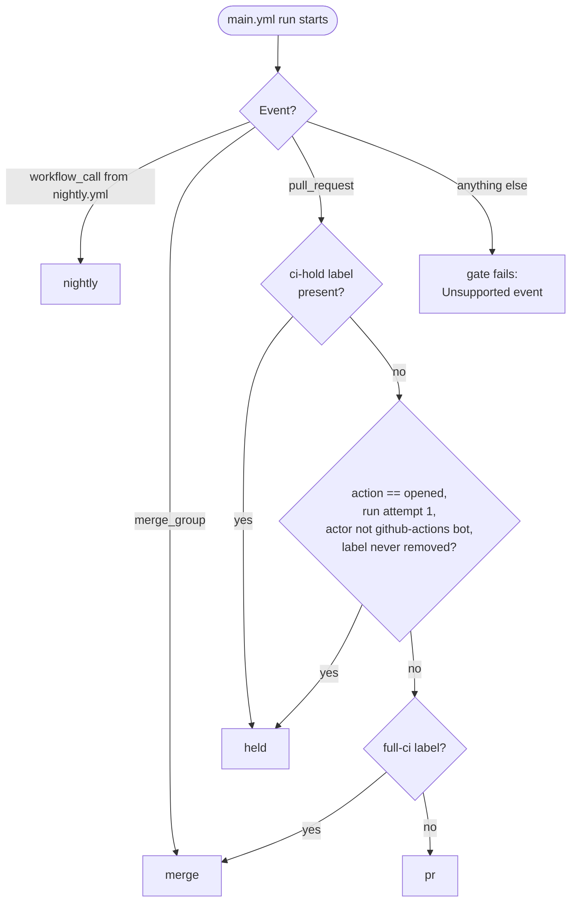
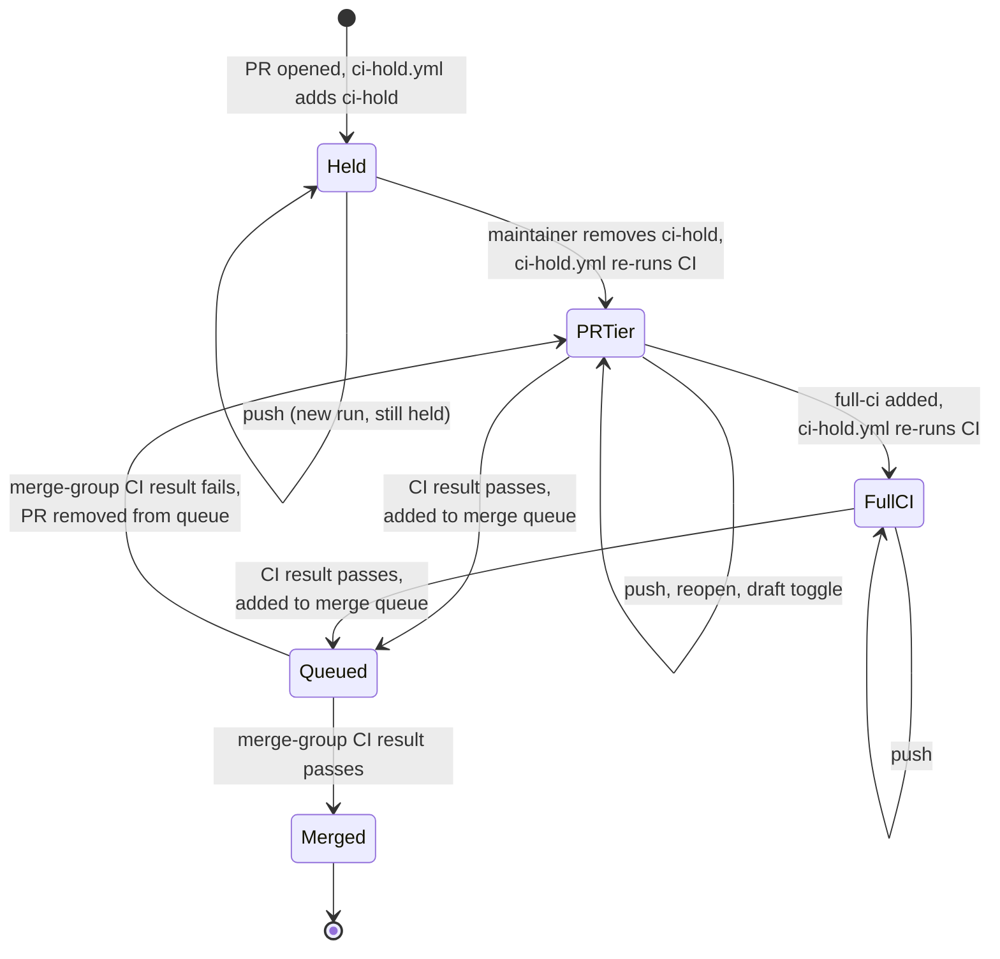
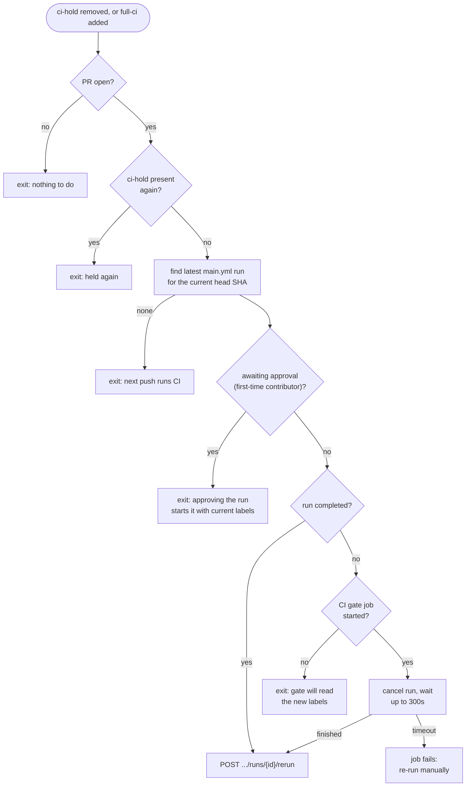
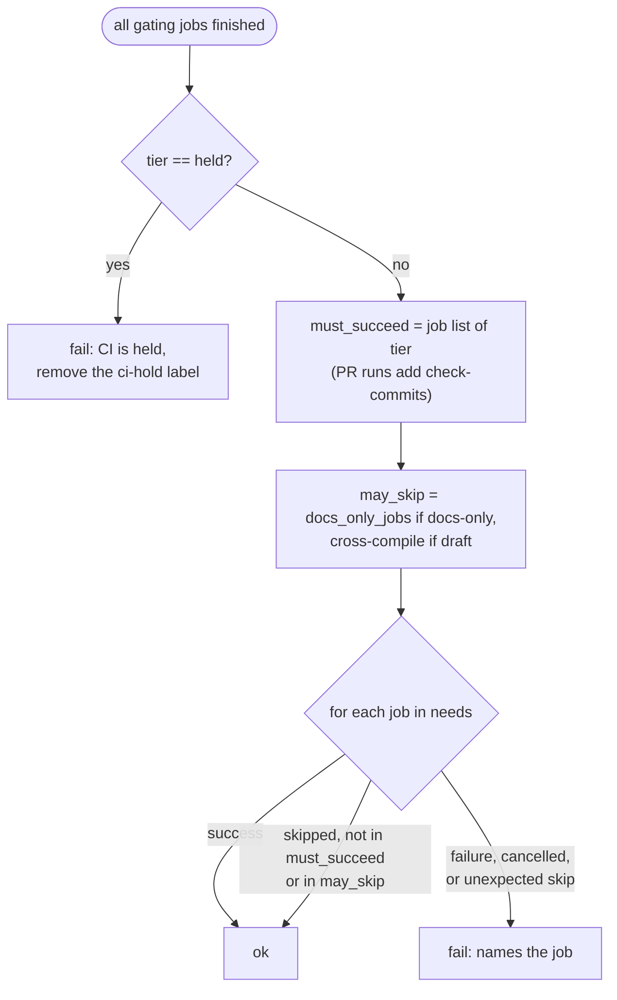
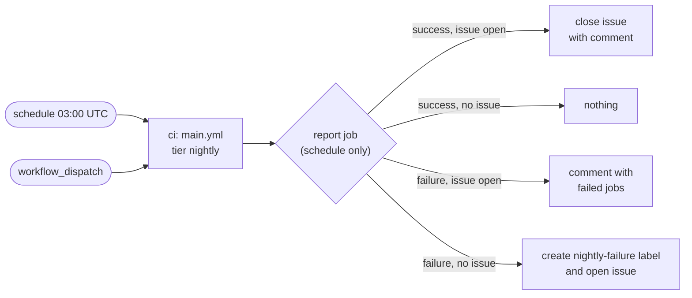
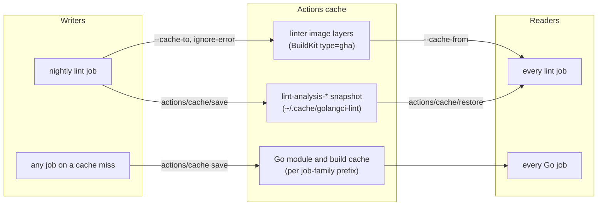

# CI Runs

lnd's CI runs in four tiers. A pull request gets a small, fast job set, the
merge queue runs the full merge-blocking set, and a nightly run on master runs
everything, including the platform itests. New pull requests start out held
and run nothing until a maintainer releases them. This document maps which
jobs run in which tier, how a run turns into the single required check
`CI result`, and which caches the jobs share. It reflects the workflows at
commit `7669a85c04`.

For local test commands, see the [development guidelines](development_guidelines.md).
For commit and release-note conventions, see the [contribution
guidelines](code_contribution_guidelines.md) and [release-note
instructions](release-notes/README.md).

## Quick reference

| I want to... | Do this |
| --- | --- |
| Run CI on a new PR | A maintainer removes the `ci-hold` label. |
| Run the merge-queue job set on a PR before queueing it | Add the `full-ci` label. |
| Skip the itests (they auto-pass) | Add the `no-itest` label. |
| Skip the release-note fragment requirement | Add the `no-changelog` label. |
| Re-run CI after changing a label | Push a commit, or let `ci-hold.yml` re-run it (see [Releasing a held PR](#releasing-a-held-pr)). |
| See why the merge queue rejected a PR | Open the `CI result` job of the queue run; it names each failed or unexpectedly skipped job. |
| Run the nightly job set now | `gh workflow run nightly.yml -R lightningnetwork/lnd --ref master` |
| Find out why nightly is red | Read the open issue labeled `nightly-failure`. |

## Tiers

The `CI gate` job (`ci-gate` in `.github/workflows/main.yml`) selects the tier
at the start of every run, and every other job reads its `tier` output. Labels
are read from the API when the gate job runs, not from the event payload, so
a re-run sees the labels as they are at that moment.

The `opened` branch exists because `ci-hold.yml` adds the label in parallel
with the first CI run, so the label may not be visible yet. Backport PRs,
opened by `github-actions[bot]`, are never held. If the issue events can't be
read, the run stays held.

| Tier | Selected for | Purpose | Runners |
| --- | --- | --- | --- |
| `held` | New PRs, and PRs with `ci-hold` | Use no runners until a maintainer looks at the PR. `CI result` fails. | 2 |
| `pr` | PR pushes, reopen, draft and ready toggles | Fast checks: static checks, lint, commits, cross-compilation, fast unit tests, release notes. | 14 (12 as draft, 6 docs-only) |
| `merge` | Merge-queue entries, and PRs with `full-ci` | The gate for landing: adds the full unit matrix, Linux itests, ARM build, backwards compatibility. | 30 (32 on a PR) |
| `nightly` | 03:00 UTC daily and manual dispatch, on master | Everything: adds the remaining DB itest variants, Windows and macOS itests, coverage. | 36 |

Runner counts are jobs per run, including `CI gate` and `CI result`. There is
no push-to-master run, so nightly is the only run of the jobs that the merge
queue doesn't run.

## A pull request from open to merge

A PR moves through the tiers as labels change and as it enters the queue. The
diagram shows the states and the event behind each transition.

`CI result` is the only required status check, and it fails in the held tier,
so a held PR can't enter the merge queue. The merge queue always tests the
merge-group commit (the PR on top of master and the PRs ahead of it), so a
`full-ci` pass on the PR doesn't replace the queue run.

## What runs where

Each row is one job in `main.yml`; matrix jobs list their legs. Split jobs
share a display name, so `Run unit tests` is one check name whether two or
ten legs run.

| Check name (job) | held | pr | merge | nightly |
| --- | :-: | :-: | :-: | :-: |
| `CI gate` (`ci-gate`) | ✅ | ✅ | ✅ | ✅ |
| `Static Checks` (`static-checks`) | | ✅ | ✅ | ✅ |
| `Lint code` (`lint`) | | ✅ | ✅ | ✅ |
| `Check commits` (`check-commits`) | | ✅ | PR only | |
| `Check pinned dependencies` (`dep-pin`, 2 legs) | | ✅ | ✅ | ✅ |
| `Check release notes updated` (`milestone-check`) | | ✅ | ✅ | |
| `Check release notes consistency` (`release-notes-consistency`) | | ✅ | ✅ | |
| `Cross compilation` i386, amd64 (`cross-compile`) | | ✅ not on drafts | ✅ | ✅ |
| `Cross compilation` arm (`cross-compile-arm`) | | | ✅ | ✅ |
| `Run unit tests` unit-cover, unit-module (`unit-test`) | | ✅ | ✅ | ✅ |
| `Run unit tests` DB tags and race, 8 legs (`unit-test-merge`) | | | ✅ | ✅ |
| `Run basic itests`, 5 backends (`basic-integration-test`) | | | ✅ | ✅ |
| `Run itests` etcd, sqlite, postgres (`integration-test`) | | | ✅ | ✅ |
| `Run itests` rpcpolling, native SQL, 5 legs (`integration-test-nightly`) | | | | ✅ |
| `Run windows itest`, `Run macOS itest` | | | | ✅ |
| `Backwards compatibility test` | | | ✅ | ✅ |
| `Send coverage report` (`finish`) | | | | ✅ |
| `Cache Cleanup` (`auto-cleanup-cache`) | | PRs by members | PR only | |
| `CI result` (`ci-result`) | ✅ fails | ✅ | ✅ | ✅ |

"PR only" in the merge column means the job runs when `full-ci` selects the
merge tier on a PR, but not in the merge queue. Two PR modifiers shrink the
set further:

- **Documentation-only PRs** (every changed file is under `docs/` or ends in
  `.md`, checked under both names of a renamed file) skip static checks,
  lint, cross-compilation, unit tests, basic itests, and the dependency pins.
  Commit and release-note checks still run. An incomplete file listing counts
  as a code change.
- **Draft PRs** skip cross-compilation. Marking a PR ready, or converting it
  back to a draft, starts a replacement run.

Unit-test and itest jobs on PRs rebase the PR onto its current base with
`.github/actions/rebase` before testing, and a conflict fails the job. Static
checks, lint, and cross-compilation test the checkout as is. Itest matrices
use `fail-fast: false`; a failed itest job uploads its zipped logs for 5 days,
and backwards-compatibility logs are kept for 7 days.

## Releasing a held PR

Label changes don't start `main.yml` runs: `on: pull_request` can't filter by
label name, so every unrelated label change would start a run and cancel the
one in progress. Instead, `ci-hold.yml` runs on `pull_request_target` and
re-runs the PR's existing CI run when `ci-hold` is removed, or when `full-ci`
is added to a PR that isn't held. The re-run keeps the PR's check
association, and its `CI gate` reads the new labels.

Only the run for the current head SHA matters, because every push starts a
new run that reads the labels itself. `ci-hold.yml` never checks out or runs
PR code. Its label changes are made with `GITHUB_TOKEN`, which doesn't trigger
workflows, so it never triggers itself.

## How a run becomes a result

`CI result` waits for every gating job and compares each result with the job
list of the selected tier. A job passes if it succeeded, or if it was skipped
and isn't expected in this tier. A failed, cancelled, or unexpectedly skipped
job fails the check. A skipped required check counts as passing on GitHub, so
this comparison is what stops a skipped job from letting an untested change
merge.

Two rules follow from this design:

1. **A new gating job needs two entries in `ci-result`:** an entry in its
   `needs` list and membership in each tier list it belongs to. A job missing
   from `needs` isn't checked at all.
2. **Cancellation differs by event.** A PR run that a new push cancels doesn't
   run `CI result`, so it can't hold the concurrency group while waiting for
   a runner. Merge-queue and nightly runs report `CI result` even when they
   are cancelled, so a cancelled queue run counts as a failure.

Pushes cancel the earlier run of the same PR or merge-group entry. Nightly
runs queue behind each other instead. `cancel-pr-ci.yml` cancels a PR's
unfinished runs when the PR is closed, except a run created after an
immediate reopen.

## Nightly

`nightly.yml` calls `main.yml` with `tier: nightly`, then reports the result
of scheduled runs in a tracking issue. GitHub only notifies the user who last
changed a workflow's schedule about scheduled failures, so the issue is where
nightly failures are visible.

Manually dispatched runs never touch the issue. Forks don't run the schedule,
but can dispatch the workflow.

## Setup and caches

Most build jobs remove unused runner toolsets, install Go 1.27.3 through
`.github/actions/setup-go`, and set `GOTMPDIR` to a directory under
`$RUNNER_TEMP`, because `/tmp` on the `ubuntu-26.04` image is a small tmpfs.
Nothing on a runner survives the job; reuse comes from Actions caches.

A cache entry saved by a PR run is only readable by that PR and by master, so
the two linter caches are written only by the nightly run on master, which
every PR can read. That also keeps PR runs from filling the repository's
shared cache space.

| Cache | Key | Notes |
| --- | --- | --- |
| Go module and build cache | OS, Go version, job-family prefix (`unit-test`, `integration-test`, `cross-compile`), `go.sum` hash | Restores the exact key or the newest prefix match. Static checks and cross-compilation cache modules only. Lint and commit checks share the `unit-test` prefix. |
| Linter image | BuildKit layer digests | Holds the compiled custom `golangci-lint`. A failed export doesn't fail lint. |
| Linter analysis | OS, Go version, hash of the lint config, tools module and custom linters, run id | Saved after both lint steps, even if lint failed; not on cancellation. |

`Cache Cleanup` deletes cache entries unused for 12 hours, and its failure
doesn't block CI. Unit tests also overlay the public `lightninglabs/lnd-fuzz`
seed corpus without replacing existing seeds.

## Troubleshooting

| Symptom | Cause | Action |
| --- | --- | --- |
| `CI result` fails with "CI is held" | The PR has `ci-hold`, or it's the first run of a new PR. | A maintainer removes `ci-hold`. |
| Removing `ci-hold` started nothing | The run awaits approval, or no run exists for the head commit. | Approve the run, or push a commit. Check the `CI hold / Run held CI` job log. |
| `CI result` names a skipped job | A job that the tier expects was skipped. | Look at that job's `if` condition, and at the tier lists in `ci-result`. |
| Check is "Expected, waiting for status" | The PR's last run predates a workflow change. | Push a commit; a re-run reuses the old workflow. |
| `Check commits` fails with "disk quota exceeded" | Go wrote its build directory to the `/tmp` tmpfs. | Confirm the job uses `.github/actions/setup-go`, which sets `GOTMPDIR`. |
| The merge queue removed a PR that passed on the PR | The merge queue runs the larger `merge` tier on the merge-group commit. | Open the queue run's `CI result`; add `full-ci` to reproduce on the PR. |
| An issue labeled `nightly-failure` is open | The last scheduled nightly failed. | Follow the job links in the issue; the next passing nightly closes it. |

## Other workflows

| Workflow | When it runs | Purpose |
| --- | --- | --- |
| `ci-hold.yml` | PR opened, labeled, or unlabeled (`pull_request_target`) | Adds `ci-hold` to new PRs and re-runs CI when it's removed. |
| `cancel-pr-ci.yml` | PR closed (`pull_request_target`) | Cancels the PR's unfinished CI runs. |
| `govulncheck.yml` | Relevant Go and dependency changes, merge queue, master, Mondays at 09:00 UTC, or dispatch | Builds release binaries and scans them. Findings are advisory while the existing baseline is remediated; scan errors fail the job. |
| `release.yaml` | Push changing `build/version.go` on `v0.*-branch`, or manual dispatch | Checks release notes and builds a draft release with reproducible binaries. |
| `verify-release.yaml` | Published release or dispatch | Verifies signatures and release binaries. |
| `docker.yml` | `v*` tag push or daily at midnight UTC | Builds and pushes multi-architecture images, and checks signing-key expiry without gating the image build. |
| `backport.yml` | Merged PR with `backport-v*` labels | Opens backport PRs. See the [backport guide](backport-workflow.md). |
| `pr-severity.yml` | PR opened, synchronized, or labeled | Classifies PRs and applies severity labels. |
| `stats.yml` | PR opened | Publishes PR statistics. |
| `claude.yml`, `claude-dedupe-issues.yml`, `gateway.yml` | Matching issue or comment events | Handles repository assistant and gateway requests. These aren't code-validation gates. |

Release mechanics are covered in the [release guide](release.md) and the
[release-branch guide](release_branch_management.md).
