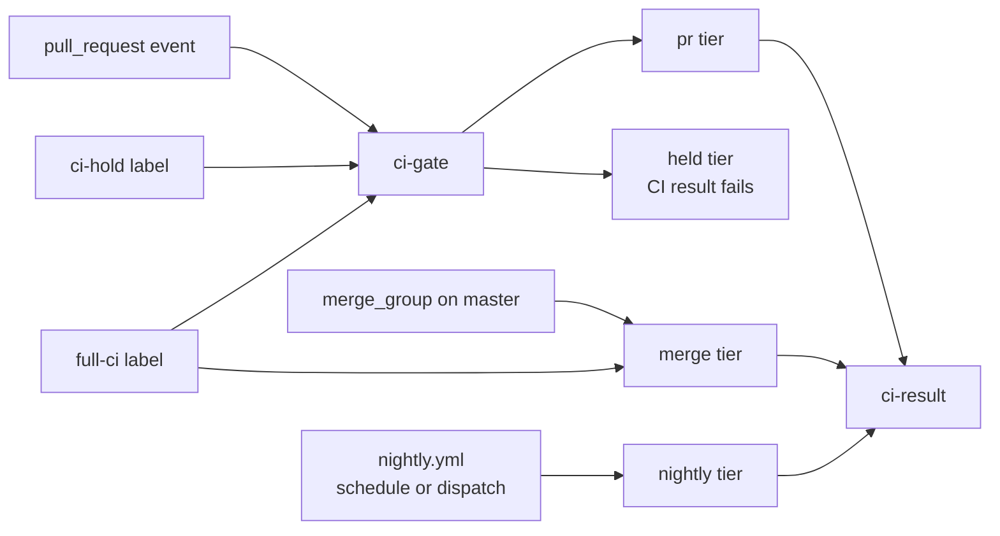
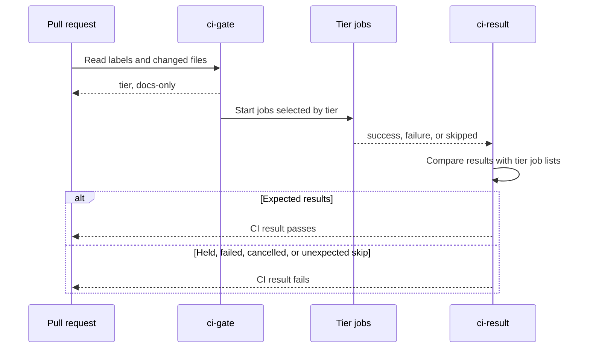

# CI Runs

The main CI workflow checks a pull request with a small job set, checks the
merge queue with the full merge-blocking job set, and tests master nightly.
This document maps those runs, the jobs in each tier, and the caches they
share. It reflects the workflow at commit `7669a85c04`.

For local test commands, see the [development guidelines](development_guidelines.md).
For commit and release-note conventions, see the [contribution
guidelines](code_contribution_guidelines.md) and [release-note
instructions](release-notes/README.md).

## Triggers and tiers

`.github/workflows/main.yml` runs on pull requests and merge-queue entries.
`nightly.yml` calls the same workflow for master. There is no push-to-master
run of the main workflow, so nightly CI is the backstop for jobs that don't run
in the merge queue.

| Trigger | Tier | What it runs |
| --- | --- | --- |
| Pull request | `pr` | Static checks, lint, per-commit checks, i386 and amd64 cross-compilation, coverage and submodule unit tests, dependency pins, and release-note checks. |
| Pull request with `full-ci` | `merge` | The full merge-blocking set before entering the queue. |
| Merge queue for master | `merge` | The PR checks except per-commit checks, plus the remaining unit tests, Linux integration tests, ARM cross-compilation, and backwards compatibility. |
| New or labeled `ci-hold` pull request | `held` | Test jobs skip and `CI result` fails. A maintainer removes the label to release CI. |
| Master at 03:00 UTC daily, or manual dispatch | `nightly` | The merge set plus extra database variants, Windows and macOS integration tests, and coverage reporting. Scheduled runs are disabled in forks. |

New PRs receive `ci-hold` from `ci-hold.yml`. The first attempt of a
human-opened PR starts held unless the label has already been removed. Label
changes don't trigger `main.yml` directly; `ci-hold.yml` re-runs the latest
workflow after `ci-hold` is removed or `full-ci` is added. A new push starts a
new run, which reads the current labels.

Draft PRs skip cross-compilation. Marking a PR ready or converting it back to a
draft triggers a replacement run. Documentation-only PRs skip the build and
test jobs listed in `docs_only_jobs`, but still run commit and release-note
checks. Detection covers `docs/*` and Markdown files; both names of a renamed
file count, and an incomplete file listing is treated as a code change.

`no-itest` auto-passes integration-test jobs, and `no-changelog` skips the
release-note fragment requirement. The separate release-note consistency check
still runs with `no-changelog`.

## What runs

Jobs within a tier run in parallel after `ci-gate`. Split matrix jobs keep the
same display names across tiers, so a check such as `Run unit tests` keeps its
identity as more matrix legs are added.

| Area | Command or matrix | Runs in |
| --- | --- | --- |
| Static checks | Sample config, formatting, module tidiness, protobuf lint, SQLC generation, RPC generation, and mobile builds. | Every non-held tier |
| Commit checks | `scripts/check-each-commit.sh` rebases through every commit and runs `scripts/check-commit.sh` on each one. | PRs, including docs-only PRs |
| Lint | `make lint` and `make lint-module` in the custom tools container. | Every non-held tier |
| Cross-compilation | `make release sys=...` for i386 and amd64, plus ARM in the merge set. | Non-draft PRs; ARM starts at merge |
| Unit tests | `unit-cover` and `unit-module`, then database-tagged and race-detector legs in the merge set. | PRs and merge respectively |
| Basic integration tests | Five chain-backend variants with 16 tranches: `btcd`, `bitcoind`, `bitcoind-miner`, `bitcoind-notxindex`, and `neutrino`. | Merge and nightly |
| Database integration tests | Etcd, SQLite, and Postgres variants with 8 tranches; additional RPC-polling and native-SQL variants nightly. | Merge and nightly |
| Platform integration tests | One Windows and one macOS run. | Nightly |
| Compatibility | `make backwards-compat-test` in Docker. | Merge and nightly |
| Dependencies | Pinned gRPC and protobuf versions. | Every non-held tier |
| Release notes | Fragment presence and release/version consistency. | PRs and merge queue |

The PR unit-test and integration-test jobs use
`.github/actions/rebase/action.yml` to rebase the PR onto its current base
before testing. A conflict fails that job. Static checks, lint, and
cross-compilation test the checkout without this rebase. The merge queue tests
GitHub's merge-group commit, and nightly tests master.

Integration-test matrices use `fail-fast: false`, so other legs finish after a
failure. Failed integration jobs zip their logs and upload them for 5 days;
backwards-compatibility logs are retained for 7 days. Coverage uploads and
cache cleanup don't gate `CI result`.

## How a run becomes a result

`ci-result` is the single required status check. It re-derives the expected job
list from the selected tier, then accepts `success` or an expected `skipped`
result. A failed, cancelled, or unexpectedly skipped gating job fails the
result. A skipped required check must never make an untested change mergeable.

Every new gating job needs two entries in `ci-result`: its `needs` entry and
its membership in the relevant tier list. A job missing from `needs` isn't
checked by the aggregate result.

Pushes cancel earlier runs of the same PR or merge-group entry. Nightly runs
queue instead of cancelling each other. Closing a PR cancels its unfinished
runs, except a fresh run created after an immediate reopen.

## Setup and caches

Most build jobs remove unused runner toolsets, install Go 1.27.3, and put Go's
temporary build directory on runner disk rather than the small `/tmp` tmpfs.
Nothing on the runner persists after the job; reuse comes from Actions caches
and uploaded artifacts.

| Cache | Contents | Restore and save behavior |
| --- | --- | --- |
| Go build and module cache | Module downloads and platform-specific build cache, keyed by OS, Go version, job-family prefix, and `go.sum` hash. | Restores an exact key or the newest matching prefix; `actions/cache` saves a miss after a successful job. Static and cross-compilation jobs cache modules only. |
| Linter image cache | BuildKit layers for the custom `golangci-lint` image, including the compiled linter. | All CI lint jobs import with `--cache-from type=gha`; only nightly exports, best-effort. |
| Linter analysis cache | `~/.cache/golangci-lint`, bind-mounted into the tools container. Keyed by OS, Go version, lint configuration, tools module, and custom plugin sources. | Every lint job restores the newest matching snapshot. Only nightly saves, after both lint steps and even if lint fails; cancellation saves nothing. |

The nightly-only linter writes keep master-derived snapshots available to PRs
without filling the shared cache with PR-scoped entries. The Go caches use
job-family prefixes such as `unit-test`, `integration-test`, and
`cross-compile`. Lint and commit checks share the `unit-test` prefix.

`auto-cleanup-cache` deletes Actions cache entries unused for 12 hours. Its
failure doesn't block CI. Unit tests also overlay the public
`lightninglabs/lnd-fuzz` corpus without replacing existing seeds.

## Other workflows

| Workflow | When it runs | Purpose |
| --- | --- | --- |
| `govulncheck.yml` | Relevant Go/dependency changes, merge queue, master, Mondays at 09:00 UTC, or dispatch | Builds release binaries and scans them. Findings are advisory while the existing baseline is remediated; scan errors fail the job. |
| `release.yaml` | `v*` tag push | Checks release notes and builds a draft release with reproducible binaries. |
| `verify-release.yaml` | Published release or dispatch | Verifies signatures and release binaries. |
| `docker.yml` | `v*` tag push or daily at midnight UTC | Builds and pushes multi-architecture images; also checks signing-key expiry without gating the image build. |
| `backport.yml` | Merged PR with `backport-v*` labels | Opens backport PRs. See the [backport guide](backport-workflow.md). |
| `pr-severity.yml` | PR opened, synchronized, or labeled | Classifies and applies PR severity labels. |
| `stats.yml` | PR opened | Publishes PR statistics. |
| `claude.yml`, `claude-dedupe-issues.yml`, `gateway.yml` | Matching issue or comment events | Handles repository assistant and gateway requests. These aren't code-validation gates. |

Release mechanics are covered in the [release guide](release.md) and
[release-branch guide](release_branch_management.md).
